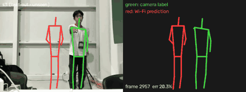
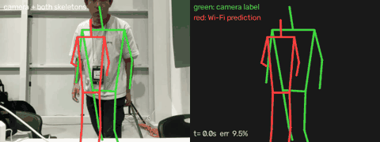

# Wi-Fi CSI 2D pose with ESP32 receivers (Person-in-WiFi 3D, low-cost build)

This folder adds a full capture -> dataset -> training pipeline to the Person-in-WiFi 3D code
(`opera/`, PETR transformer) using cheap hardware instead of Intel 5300 cards:

- **Transmitters (3):** Raspberry Pi 5 + Panda PAU0F (MT7921, tx1) and 2x RTL8192EU dongles (tx2, tx3),
  injecting 6 Mbps OFDM frames on channel 6 at 100 frames/s each.
- **Receivers (3):** ESP32-S3 boards measuring CSI (52 subcarriers) for every injected frame,
  streaming it over USB (one to the Mac, two to a second Pi that forwards over UDP).
- **Labels:** MacBook webcam + MediaPipe pose (14 keypoints, 2D + 3D).
- **Model:** the repo's PETR detector in 2D mode; input = 3 rx x 3 tx x 20 packets x 30 subcarriers.

Result (30 min of data, 1 person, train s1+s2, test on unseen s3, epoch 10, single most-confident pose):
joint error 12.5% of image, 54% of joints within 10% — vs 15.5% / 30% for always predicting the average
pose and 17.5% / 23% for the same model trained on shuffled (unpaired) CSI.

Held-out session s3 (never seen in training). Green = camera label, red = prediction from Wi-Fi CSI only
(epoch-5 model; first clip is one of the better stretches, second is typical):




The model tracks presence, height and overall posture and often the position; it still misses distinctive
arm poses and drifts left-right by up to a body width (see `train/IMPROVEMENTS.md`).

## Layout

```
csi_demo/
  esp_ble_rx/      ESP32-S3 receiver firmware (ESP-IDF): CSI from tx ids 1-15, live USB stream + BLE buffer
  tx/              tx.py injector + csi-tx-all.sh (one injector per dongle, matched by MAC)
  pi/              systemd units and /etc/csi-tx.conf for the Pis
  pau0f_driver/    mt7921 patch + installer (honour radiotap rate on injected frames)
  rtl_driver/      rtl8xxxu patch (same for RTL8192EU)
  live/            hub.py (Mac): USB + UDP CSI ingest, webcam pose, session recorder, live page;
                   forwarder.py (Pi): USB CSI -> UDP; csi_frames.py: stream parser
  dataset/         build_2d_cache.py: sessions -> training cache (CSI windows + keypoints)
  train/           eval_room1.py (strict held-out evaluation), IMPROVEMENTS.md (v2 plan), Wiception3D tools
  ble/             BLE collector + per-link check (fallback path, no USB)
  capture/         BLE-era session recorder (MediaPipe helpers reused by live/hub.py)
  legacy/          superseded experiments (serial dashboard, ESP-NOW tx, old inference)
configs/wifi/petr_wifi_esp_multitx_2d.py   training config for the 9-link dataset
```

Changes to the paper's code (`opera/`, `third_party/mmdet`): 2D keypoint mode (`coord_dim`), configurable
CSI token width (`csi_in_channels`), cached dataset loader, `pck2d` metric, faster keypoint match cost.

## What is and is not reproducible

- **Reproducible from this repo:** the whole pipeline — firmware, driver patches, transmitter/forwarder
  services, live hub + recorder, dataset builder, training config, evaluation — on equivalent hardware.
- **Not bit-exact:** the reported numbers come from our own recordings (one person, one room, 30 min),
  which are not published (they include video of the subject). With your own hardware you get your own
  dataset; expect the same *test* (real CSI beats mean-pose and shuffled-CSI baselines on a held-out
  session), not the same digits. Wi-Fi CSI depends on the room, device placement and the person.
- **Training randomness:** train with `--seed 0 --deterministic` for repeatable runs on one machine.
- **Tested versions:** Mac Python 3.12.12 (`requirements.txt`, pinned); ESP-IDF v5.5.1 (components pinned
  in `esp_ble_rx/dependencies.lock`); Raspberry Pi OS 13 (trixie), kernel 6.18.50+rpt-rpi-2712; training
  Python 3.8.20, PyTorch 1.13.1+cu117, MMCV 1.5.3 (built with CUDA ops), MMDetection 2.25.0 (vendored),
  NumPy 1.23.5, on an NVIDIA A100.
- **Setup-specific values you must change:**

  | What | Where |
  |---|---|
  | Transmitter dongle MACs | `pi/csi-tx.conf` |
  | Mac IP the receiver Pi forwards to | `pi/csi-forward.service` (`--hub`) |
  | Receiver board names by USB serial | `live/forwarder.py --name MAC=NAME` (or rename boards over BLE) |
  | Transmitter Pi IPs for the status panel | `live/hub.py --pi LABEL=IP` |
  | Webcam index | `live/hub.py --camera N` |
  | Board names / order in the dataset | `dataset/build_2d_cache.py --boards ...` |
  | Layout description saved per session | `LAYOUT` in `live/hub.py` |

## Reproduce

Not in git (regenerated or downloaded): `data/` (recordings, caches), `work_dirs/`, ESP-IDF `build/`,
`managed_components/`, `sdkconfig`, model weights (`*.task` is downloaded by the hub on first run).

### 1. Host (Mac)
```bash
python3 -m venv csi_demo/.venv && csi_demo/.venv/bin/pip install -r csi_demo/requirements.txt
```

### 2. Receivers (ESP32-S3, ESP-IDF 5.5)
```bash
cd csi_demo/esp_ble_rx && idf.py set-target esp32s3 && idf.py -p <PORT> flash
```
Boards name themselves `CSI-<last 3 MAC bytes>`; rename over BLE with the `NAME=` command if wanted.

### 3. Transmitter Pis (Raspberry Pi OS, kernel headers installed)
```bash
# PAU0F: bash csi_demo/pau0f_driver/install.sh
# RTL8192EU: add drivers/net/wireless/realtek/rtl8xxxu to a kernel source checkout matching `uname -r`,
#   python3 csi_demo/rtl_driver/apply_patch.py <tree>/drivers/net/wireless/realtek/rtl8xxxu/core.c
#   make -C /lib/modules/$(uname -r)/build M=<that dir> CONFIG_RTL8XXXU=m modules
#   sudo cp rtl8xxxu.ko /lib/modules/$(uname -r)/updates/ && sudo depmod -a
sudo apt install python3-scapy
cp csi_demo/tx/tx.py ~/tx.py
sudo install -m755 csi_demo/tx/csi-tx-all.sh /usr/local/bin/csi-tx-all
sudo install -m644 csi_demo/pi/csi-tx.conf /etc/csi-tx.conf        # edit MACs for your dongles
sudo install -m644 csi_demo/pi/csi-tx.service /etc/systemd/system/ && sudo systemctl enable --now csi-tx
```
Receiver Pi (boards on USB): copy `live/forwarder.py` + `live/csi_frames.py` to `~`, set the Mac's IP in
`pi/csi-forward.service`, install and enable it the same way.

### 4. Record
```bash
csi_demo/.venv/bin/python csi_demo/live/hub.py --camera 1      # http://localhost:8766/live
```
Check all 9 links show LIVE and the whole body is in frame, then Start sessions (e.g. s1, s2, s3, 10 min).

### 5. Build dataset, train, evaluate
```bash
csi_demo/.venv/bin/python csi_demo/dataset/build_2d_cache.py --boards CSI-298988,CSI-wroom1,CSI-wroom2 \
  --tx-ids 1,2,3 --session data/sessions/s1/csi:data/sessions/s1/labels \
  --session data/sessions/s2/csi:data/sessions/s2/labels --session data/sessions/s3/csi:data/sessions/s3/labels \
  --out data/cache_9link --split-by-session s3
# GPU machine with this repo's MMCV/MMDet environment (see docs/get_started.md):
PYTHONPATH=. python tools/train.py configs/wifi/petr_wifi_esp_multitx_2d.py --seed 0 --deterministic
PYTHONPATH=. python csi_demo/train/eval_room1.py configs/wifi/petr_wifi_esp_multitx_2d.py \
  work_dirs/petr_wifi_esp_multitx_2d/epoch_10.pth --cache data/cache_9link
```
Use your own board names in `--boards`. For a control, train once more on a copy of the cache with
`train/csi.npy` rows permuted; the real model must beat it and the mean-pose baseline.
